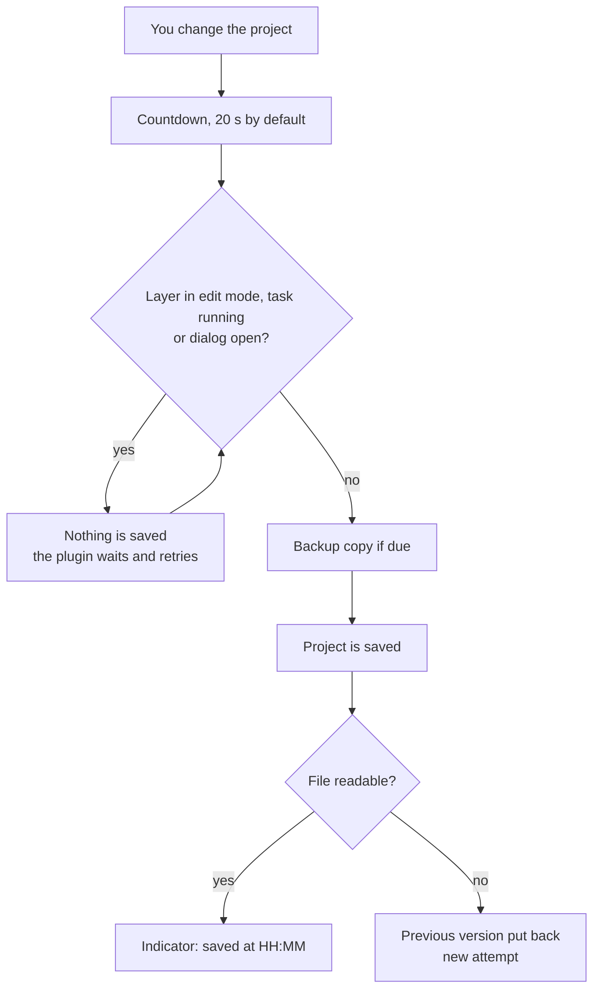
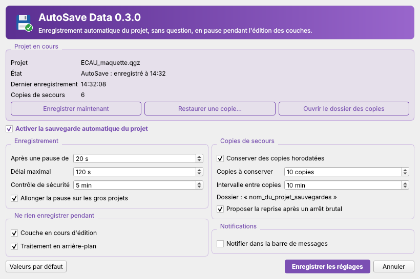
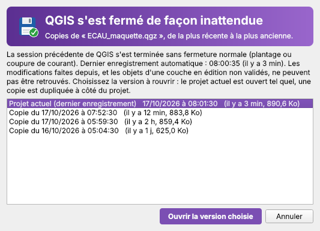

<p align="center">
  
</p>

<p align="center">
  <a href="README.md">Français</a> · <b>English</b>
</p>

<p align="center">
  <a href="https://github.com/steph20-seka/autosave-data-qgis/actions/workflows/ci.yml"></a>
  
  
  
  <a href="https://github.com/steph20-seka/autosave-data-qgis/releases/latest"></a>
</p>

## Why this plugin

A QGIS project that closes unexpectedly can cost hours of layout work, styling and processing. Existing autosave plugins save at a fixed interval, even while you are digitizing, or ask a question at every cycle.

**AutoSave Data** follows one rule: save without ever asking, except when saving could get in your way. It leaves the project alone while a layer is being edited, keeps backup copies, and checks that the written file is readable.

> The user interface is in French for now. An English translation is planned.

## How it decides



## Features

| | |
|---|---|
| **Silent saving** | After 20 s without changes, with no confirmation dialog. A maximum delay (120 s) forces a save during continuous work, except while paused (editing, processing). |
| **Pause while editing** | While a vector layer is in edit mode (digitizing, data entry), the project is not touched. Layer edits are never committed for you. |
| **Pause during processing** | The plugin waits while a background algorithm runs or a modal dialog is open. |
| **Backup copies** | Timestamped copy of the project file before it is overwritten, in `project_name_sauvegardes`, with rotation (10 copies by default). |
| **Overwrite protection** | If the project file was changed outside your session (a colleague on a shared folder, another QGIS window), automatic saving writes nothing and says so once. "Save project now" then overwrites the file after copying the foreign version into the backups. |
| **Verified writes** | After every save the file is checked. If it is unreadable, the previous version is put back and a new attempt is made. |
| **One-click restore** | A dialog lists the copies (date, age, size). The chosen copy is duplicated next to the project and opened, nothing is overwritten. |
| **Recovery after an abrupt stop** | After a crash or power cut, the next QGIS start offers to reopen the project or a backup copy ("12 min ago"), much like Word does when it reopens. |
| **Status indicator** | The status bar shows: active, changes pending, paused (editing "roads"), saved at 14:32, file changed elsewhere, or failed. Clicking it opens the settings. |
| **Settings and dashboard** | Clicking the toolbar icon or the status indicator opens a window showing the project state (last save, number of copies) with buttons to save, restore or open the backup folder, then every option. Options with no effect are greyed out, and "Defaults" resets everything. |
| **Adaptive pause** | On large projects the pause grows (10 times the duration of the last save) so QGIS does not freeze every 20 seconds. |

## Preview

<p align="center">
  
  
</p>
<p align="center"><sub>Settings and recovery dialogs (Qt rendering, outside QGIS).</sub></p>

## Installation

### From a ZIP file (recommended)

1. Download `autosave_data-X.Y.Z.zip` from the [Releases](https://github.com/steph20-seka/autosave-data-qgis/releases/latest) page, under Assets. Do not use the repository's "Code > Download ZIP" button: that file (`autosave-data-qgis-main.zip`) holds the whole repository and QGIS rejects it with the error "No module named 'autosave-data-qgis-main/autosave_data'".
2. In QGIS: **Plugins > Manage and Install Plugins > Install from ZIP**.
3. Select the file, then **Install Plugin**.
4. In the **Installed** tab, check that **AutoSave Data** is ticked.

A floppy disk icon appears in the toolbar. One click turns autosave on or off. The status indicator sits on the right of the status bar.

### From source

```bash
git clone https://github.com/steph20-seka/autosave-data-qgis.git
```

Copy the `autosave_data/` folder into your QGIS profile's plugins folder, then restart QGIS:

| System | Folder |
|---|---|
| Windows | `%APPDATA%\QGIS\QGIS3\profiles\default\python\plugins` |
| Linux | `~/.local/share/QGIS/QGIS3/profiles/default/python/plugins` |
| macOS | `~/Library/Application Support/QGIS/QGIS3/profiles/default/python/plugins` |

To build the ZIP yourself: `python scripts/build_zip.py` (output in `dist/`).

## Usage

1. **Save your project once** (Project > Save As). A project without a file cannot be written.
2. Work as usual. The rest is automatic.
3. Click the **AutoSave Data** toolbar icon, or the indicator at the bottom right of the status bar, to open the settings and the project state.
4. The **Plugins > AutoSave Data** menu also offers: enable switch, save now, restore a backup copy, open the backup folder, settings.

## Settings

| Setting | Default | Range |
|---|---|---|
| Save after a pause of | 20 s | 5 to 600 s |
| Maximum delay during continuous work | 120 s | 30 to 3600 s |
| Safety check every | 5 min | 1 to 120 min |
| Lengthen the pause on large projects | yes | |
| Pause while a layer is in edit mode | yes | |
| Wait while a task is running | yes | |
| Backup copies | yes | 1 to 100 kept, one every 1 to 240 min |
| Offer recovery after an abrupt stop | yes | |
| Message bar notification | no | |

The first backup of a project in a session is always made before the first overwrite. This protects an older project that QGIS would otherwise rewrite in its newer format.

## What it does not do

- It does not save the features of a layer in edit mode: remember to commit your layer edits. It protects the project file (added layers, styles, layouts, processing results).
- It does not sync anything online. Copies stay next to the project.
- It does not save a project that has never been saved.
- Recovery after an abrupt stop only brings back what is on disk: work done since the last automatic save is lost. The versions offered are the backup copies, not snapshots every 3 minutes.

## Known limitations

- Saving a large project briefly freezes the interface. The adaptive pause reduces this without removing it.
- Projects stored in a database are saved, without backup copies or file check.
- A project in a read-only folder is reported once and is not written.
- Version 0.x: the logic is covered by 115 automated tests (simulated QGIS) and the dialogs are checked under Qt 5 and Qt 6. Feedback from real use in QGIS 3.x and 4.x is welcome in the [Issues](https://github.com/steph20-seka/autosave-data-qgis/issues).

## Compatibility

QGIS 3.22 and above. The code is written for Qt 5 and Qt 6 (imports only through `qgis.PyQt`, no external dependency) and declares QGIS 4 compatibility (`qgisMaximumVersion=4.99`), but it has not yet been tried in a real QGIS 4.

## Planned

- Snapshots more frequent than backup copies, to go back "3 minutes".
- Copy of a layer's data before its editing starts.
- Per-project settings.
- English interface.

## Development

```bash
pip install -r requirements-dev.txt
python -m pyflakes autosave_data tests scripts
pytest
python scripts/build_zip.py
```

See [CONTRIBUTING.md](CONTRIBUTING.md) and the [changelog](CHANGELOG.md) (detailed history in French: [docs/historique](docs/historique/journal-de-developpement.md)).

## Author

Stéphane Seka Kouassi, geographer and cartographer, Bouaké (Côte d'Ivoire). [@steph20-seka](https://github.com/steph20-seka)

## License

[GNU GPL v2 or later](LICENSE), like QGIS.
