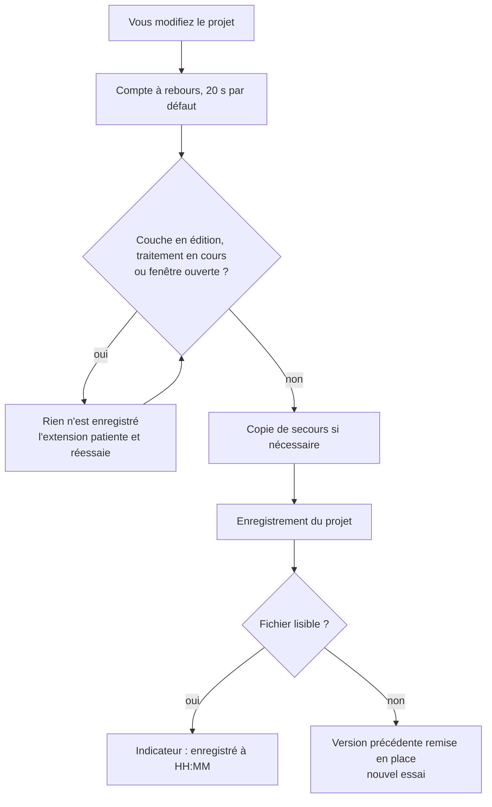

<p align="center">
  
</p>

<p align="center">
  <b>Français</b> · <a href="README.en.md">English</a>
</p>

<p align="center">
  <a href="https://github.com/steph20-seka/autosave-data-qgis/actions/workflows/ci.yml"></a>
  
  
  
  <a href="https://github.com/steph20-seka/autosave-data-qgis/releases/latest"></a>
</p>

## Pourquoi cette extension

Un projet QGIS qui se ferme sans prévenir, c'est parfois des heures de mise en page, de symbologie et de traitements perdues. Les extensions d'enregistrement automatique existantes enregistrent à intervalle fixe, y compris pendant que vous numérisez, ou vous posent une question à chaque cycle.

**AutoSave Data** suit une règle simple : enregistrer sans jamais demander, sauf quand cela risque de gêner. Elle ne touche pas au projet pendant l'édition d'une couche, elle garde des copies de secours, et elle vérifie que le fichier écrit est lisible.

## Comment elle décide



## Fonctions

| | |
|---|---|
| **Enregistrement silencieux** | Après une pause de 20 s sans modification, sans fenêtre de confirmation. Un délai maximal (120 s) force l'enregistrement en travail continu, sauf pendant une pause (édition, traitement). |
| **Pause pendant l'édition** | Tant qu'une couche vectorielle est en mode édition (vectorisation, saisie), le projet n'est pas touché. Les modifications de couche ne sont jamais validées à votre place. |
| **Pause pendant les traitements** | L'extension patiente tant qu'un algorithme tourne en arrière-plan ou qu'une fenêtre modale est ouverte. |
| **Copies de secours** | Copie horodatée du fichier projet avant l'écrasement, dans `nom_du_projet_sauvegardes`, avec rotation (10 copies par défaut). |
| **Écriture vérifiée** | Après chaque enregistrement, le fichier est contrôlé. S'il est illisible, la version précédente est remise en place et un nouvel essai a lieu. |
| **Restauration en un clic** | Une fenêtre liste les copies (date, ancienneté, taille). La copie choisie est dupliquée à côté du projet puis ouverte, sans rien écraser. |
| **Reprise après un arrêt brutal** | Après un plantage ou une coupure de courant, QGIS propose au démarrage suivant de rouvrir le projet ou une copie de secours (« il y a 12 min »), comme le fait Word à la réouverture. |
| **Indicateur d'état** | La barre d'état affiche : actif, modifications en attente, en pause (édition de « routes »), enregistré à 14:32, fichier modifié ailleurs, ou échec. Un clic dessus ouvre les réglages. |
| **Réglages et tableau de bord** | Un clic sur l'icône de la barre d'outils ou sur l'indicateur ouvre une fenêtre qui montre l'état du projet (dernier enregistrement, nombre de copies) et permet d'enregistrer, de restaurer ou d'ouvrir le dossier des copies, puis de régler chaque option. Les options sans effet sont grisées, et « Valeurs par défaut » remet tout à zéro. |
| **Protection contre l'écrasement** | Si le fichier projet a été modifié en dehors de votre session (collègue sur un dossier partagé, autre fenêtre de QGIS), l'enregistrement automatique n'écrit rien et le signale une fois. « Enregistrer le projet maintenant » écrase alors le fichier après avoir copié la version étrangère dans les copies de secours. |
| **Pause adaptative** | Sur un gros projet, la pause s'allonge (10 fois la durée du dernier enregistrement) pour que QGIS ne se fige pas toutes les 20 secondes. |

## Aperçu

<p align="center">
  
  
</p>
<p align="center"><sub>Fenêtres de réglages et de reprise (rendu Qt, hors de QGIS).</sub></p>

## Installation

### Depuis un fichier ZIP (recommandé)

1. Téléchargez `autosave_data-X.Y.Z.zip` sur la page [Releases](https://github.com/steph20-seka/autosave-data-qgis/releases/latest), dans la rubrique Assets. N'utilisez pas le bouton « Code > Download ZIP » du dépôt : ce fichier (`autosave-data-qgis-main.zip`) contient tout le dépôt et QGIS le refuse avec l'erreur « No module named 'autosave-data-qgis-main/autosave_data' ».
2. Dans QGIS : **Extensions > Installer/Gérer les extensions > Installer depuis un ZIP**.
3. Sélectionnez le fichier, puis **Installer l'extension**.
4. Dans l'onglet **Installées**, vérifiez que **AutoSave Data** est cochée.

Une icône disquette apparaît dans la barre d'outils. Un clic l'active ou la désactive. L'indicateur d'état s'affiche à droite de la barre d'état.

### Depuis les sources

```bash
git clone https://github.com/steph20-seka/autosave-data-qgis.git
```

Copiez le dossier `autosave_data/` dans le dossier des extensions de votre profil QGIS, puis redémarrez QGIS :

| Système | Dossier |
|---|---|
| Windows | `%APPDATA%\QGIS\QGIS3\profiles\default\python\plugins` |
| Linux | `~/.local/share/QGIS/QGIS3/profiles/default/python/plugins` |
| macOS | `~/Library/Application Support/QGIS/QGIS3/profiles/default/python/plugins` |

Pour fabriquer le ZIP vous-même : `python scripts/build_zip.py` (résultat dans `dist/`).

## Utilisation

1. **Enregistrez une première fois** votre projet (Projet > Enregistrer sous). Un projet sans fichier ne peut pas être écrit.
2. Travaillez normalement. Le reste est automatique.
3. Cliquez sur l'icône **AutoSave Data** de la barre d'outils, ou sur l'indicateur en bas à droite de la barre d'état, pour ouvrir les réglages et l'état du projet.
4. Le menu **Extensions > AutoSave Data** propose aussi :
   - Sauvegarde automatique activée (case à cocher) ;
   - Enregistrer le projet maintenant ;
   - Restaurer une copie de secours ;
   - Ouvrir le dossier des copies de secours ;
   - Réglages.

## Réglages

| Réglage | Défaut | Plage |
|---|---|---|
| Enregistrer après une pause de | 20 s | 5 à 600 s |
| Délai maximal en travail continu | 120 s | 30 à 3600 s |
| Contrôle de sécurité toutes les | 5 min | 1 à 120 min |
| Allonger la pause sur les gros projets | oui | |
| Pause pendant l'édition d'une couche | oui | |
| Patienter pendant un traitement | oui | |
| Copies de secours | oui | 1 à 100 conservées, 1 toutes les 1 à 240 min |
| Proposer la reprise après un arrêt brutal | oui | |
| Notification dans la barre de messages | non | |

La première copie de secours d'un projet dans une session est toujours faite avant le premier écrasement. Cela protège un ancien projet que QGIS réécrirait dans son format récent.

## Ce que l'extension ne fait pas

- Elle n'enregistre pas les objets d'une couche en édition : pensez à valider vos modifications de couche. Elle protège le fichier projet (couches ajoutées, styles, mises en page, résultats de traitements).
- Elle ne synchronise rien en ligne. Les copies restent à côté du projet.
- Elle n'enregistre pas un projet qui n'a encore jamais été enregistré.
- La reprise après un arrêt brutal ne retrouve que ce qui est sur le disque : le travail fait depuis le dernier enregistrement automatique est perdu. Les versions proposées sont celles des copies de secours, pas des instantanés toutes les 3 minutes.

## Limites connues

- L'enregistrement d'un gros projet fige brièvement l'interface. La pause adaptative limite ce désagrément, sans le supprimer.
- Les projets stockés en base de données sont enregistrés, sans copie de secours ni contrôle de fichier.
- Un projet dans un dossier en lecture seule est signalé une fois et n'est pas écrit.
- La détection d'une modification externe compare la date et la taille du fichier. Un outil de synchronisation qui touche le fichier sans le changer peut la déclencher à tort : « Enregistrer le projet maintenant » ou la réouverture du projet lève l'alerte.
- Version 0.x : la logique est couverte par 116 tests automatisés (QGIS simulé) et les fenêtres sont vérifiées sous Qt 5 et Qt 6. Les retours d'usage dans QGIS 3.x et 4.x sont les bienvenus dans les [Issues](https://github.com/steph20-seka/autosave-data-qgis/issues).

## Compatibilité

QGIS 3.22 et supérieur. Le code est écrit pour Qt 5 et Qt 6 (imports uniquement via `qgis.PyQt`, sans dépendance externe) et déclare la compatibilité avec QGIS 4 (`qgisMaximumVersion=4.99`), mais il n'a pas encore été essayé dans un QGIS 4 réel. L'interface est en français pour l'instant.

## Prévu

- Instantanés plus fréquents que les copies de secours, pour revenir « à il y a 3 minutes ».
- Copie de la donnée d'une couche avant le début de son édition.
- Réglage par projet.
- Interface en anglais.

## Développement

```bash
pip install -r requirements-dev.txt
python -m pyflakes autosave_data tests scripts
pytest
python scripts/build_zip.py
```

```
autosave_data/
  core.py     logique pure : réglages, décision enregistrer/patienter/ignorer,
              copies de secours, vérification du fichier, restauration
  plugin.py   intégration QGIS : signaux du projet, minuteries, barre d'état, menu
  dialog.py   fenêtres de réglages et de restauration
tests/        QGIS et Qt simulés (conftest.py), exécutables sans QGIS
```

Voir [CONTRIBUTING.md](CONTRIBUTING.md) et le [journal des modifications](CHANGELOG.md) (historique détaillé : [docs/historique](docs/historique/journal-de-developpement.md)).

## Auteur

Stéphane Seka Kouassi, géographe cartographe, Bouaké (Côte d'Ivoire). [@steph20-seka](https://github.com/steph20-seka)

## Licence

[GNU GPL v2 ou ultérieure](LICENSE), comme QGIS.
